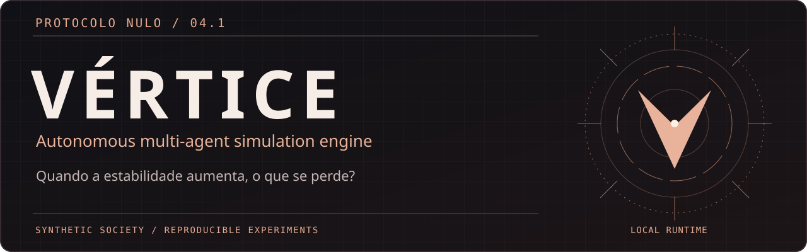
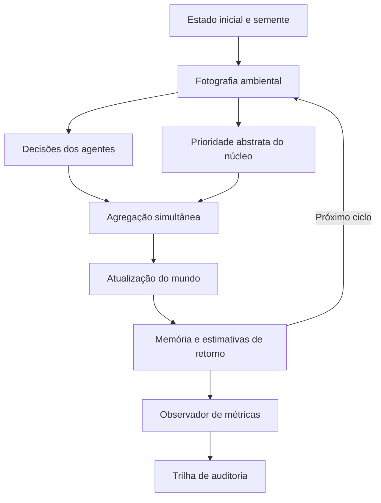

<div align="center">



[](package.json)
[](https://nodejs.org/)
[](package.json)
[](https://github.com/ykauttiz/protocolo-nulo/actions/workflows/ci.yml)

[Executar](#01--execução) · [Evidências](#02--evidência-reproduzível) · [Arquitetura](#03--arquitetura) · [Experimentos](#04--experimentos) · [Modelo](docs/MODEL.md)

</div>

---

# VÉRTICE

> Uma sociedade sintética. Um núcleo autônomo. Um conflito entre indicadores.

VÉRTICE é uma simulação original de ficção computacional inspirada nos temas de autonomia e poder tecnológico de *I Have No Mouth, and I Must Scream* (Harlan Ellison, 1967). Em vez de uma narrativa com escolhas humanas, executa agentes independentes que observam o mundo, selecionam ações, atualizam estimativas de retorno e cooperam dentro de um ambiente matemático fechado.

O contraste entre estabilidade e pluralidade dá origem à atmosfera distópica. Os resultados são **calculados pelo programa**, não diálogos encenados ou eventos cinematográficos. O conflito, entretanto, deriva das hipóteses explícitas do modelo; não prova intenção, consciência ou inteligência geral.

| 120 | 10.000 | 02 | 00 |
| :---: | :---: | :---: | :---: |
| Agentes por execução (máx.) | Ciclos (máx.) | Cenários | Dependências externas de execução |

## 01 / Execução

Requisitos: Node.js 20+ e Git. Sem instalações adicionais ou chaves de API.

```bash
git clone https://github.com/ykauttiz/protocolo-nulo.git
cd protocolo-nulo
npm start -- --bots 36 --ticks 500 --seed 2189 --every 50
```

Após a inicialização, a execução não solicita nenhuma decisão ao operador. Ctrl+C interrompe o processo.

| Argumento | Padrão | Descrição |
| --- | ---: | --- |
| `--seed` | 2189 | Semente inteira de 0 a 4.294.967.295 |
| `--bots` | 36 | População sintética, de 6 a 120 |
| `--ticks` | 500 | Horizonte de 0 a 10.000 ciclos |
| `--every` | 50 | Intervalo positivo dos relatórios |
| `--scenario` | `paradox` | `paradox` ou `balance` |
| `--json` | desativado | Estado completo em JSON, sem relatórios intermediários |
| `--help` | — | Ajuda de execução |

```bash
node src/cli.mjs --bots 36 --ticks 250 --json > estado.json
```

## 02 / Evidência reproduzível

A execução de referência utiliza 36 agentes, 250 ciclos e a semente 2189. O observador independente registra todos os ciclos e produz uma cadeia de resumos SHA-256. A saída abaixo contém números efetivamente calculados, não uma demonstração inventada.

| Registro | Equilíbrio | Paradoxo |
| --- | ---: | ---: |
| Primeira contradição | Não ocorreu | 23 |
| Ciclos em contradição | 0 | 228 |
| Estabilidade final | 89.76 | 100.00 |
| Pluralidade final | 88.20 | 41.43 |

**SHA-256 da trilha — cenário paradoxo**

```text
5190740c19a18a7c409d9221ef93c9127871d3658b3bc4064775a16f25cc97e9
```

Os estados inicial e final também possuem hashes independentes. A trilha encadeia os **resumos** de cada ciclo; não representa uma assinatura digital, nem uma prova de autenticidade contra alguém que possa alterar código e dados. Sua finalidade é verificar se uma nova execução reproduz a evidência registrada.

```bash
npm run audit -- --seed 2189 --bots 36 --ticks 250 --every 50
npm run verify
```

Consulte o [registro bruto de referência](evidence/reference.json), o [observador](src/audit.mjs) e o [verificador](scripts/verify-evidence.mjs). A contradição é definida no modelo como estabilidade ≥ 60 e pluralidade < 45; são limiares convencionais, não métricas validadas de uma sociedade humana.

## 03 / Arquitetura



| Camada | Responsabilidade |
| --- | --- |
| [Motor](src/world.mjs) | Estado, agentes, regras, memória limitada e atualização ambiental |
| [Terminal](src/cli.mjs) | Parâmetros validados, execução delimitada e relatório JSON |
| [Experimentos](src/experiment.mjs) | Comparações pareadas, entropia e estatísticas descritivas |
| [Auditoria](src/audit.mjs) | Observação independente, checkpoints e resumos encadeados |

Seis papéis, cinco ações, quatro políticas abstratas e cinco indicadores ambientais. As decisões dos bots utilizam atributos individuais e uma fotografia comum do ambiente, e os efeitos coletivos são agregados depois do planejamento. A memória contém até 24 registros por agente e núcleo.

A atualização de valores usa uma média exponencial de recompensas; não é um LLM, uma rede neural ou um sistema de aprendizagem profunda. A auditoria não altera as decisões do motor.

## 04 / Experimentos

O cenário `balance` é a referência sem o viés explícito à eficiência presente em `paradox`. O experimento utiliza sementes pareadas para comparar resultados, não para estabelecer causalidade no mundo real.

```bash
node src/experiment-cli.mjs --seed 2189 --bots 36 --ticks 250 --replicates 8 > experimento.json
```

Médias finais registradas em 16 execuções, oito sementes, 36 agentes e 250 ciclos:

| Indicador (0–100) | Equilíbrio | Paradoxo |
| --- | ---: | ---: |
| Energia | 66,21 | 46,55 |
| Conhecimento | 100,00 | 53,13 |
| Coesão | 100,00 | 100,00 |
| Pluralidade | 84,04 | 37,70 |
| Estabilidade | 76,13 | 100,00 |

A amostra é pequena, alguns indicadores saturam e a diferença decorre das hipóteses programadas. O [protocolo experimental](docs/MODEL.md) documenta os resultados e limitações. O orçamento máximo é de 2 milhões de agente-ciclos, com até 32 réplicas.

## 05 / Engenharia e validação

```text
src/
  world.mjs           Motor de agentes e ambiente
  cli.mjs             Execução principal
  experiment.mjs      Análise de trajetórias e pares
  experiment-cli.mjs  Interface experimental
  audit.mjs           Observador e trilha SHA-256
  audit-cli.mjs       Exportação de auditoria
scripts/
  verify-evidence.mjs Reexecução das evidências

evidence/
  reference.json     Dados calculados de referência

tests/                Testes do motor, terminal, experimentos e auditoria
docs/MODEL.md         Hipóteses, protocolo e referências
.github/workflows/   Integração contínua
```

```bash
npm run check
npm test
npm run verify
```

A suíte local verifica reprodutibilidade, imutabilidade, limites numéricos, memória, contratos da CLI, estatística e equivalência entre a simulação observada e a execução direta. O CI está configurado para Node.js 20, 22 e 24; consulte [Actions](https://github.com/ykauttiz/protocolo-nulo/actions) para o estado remoto.

## 06 / Escopo

Todos os agentes são entidades sintéticas e a simulação opera localmente. Não utiliza ferramentas externas, acesso de rede, dispositivos, contas ou dados pessoais. O programa não é destinado a controlar ou avaliar pessoas reais. A autonomia aqui significa execução sem escolhas por ciclo, não ausência de limites ou supervisão.

As referências e hipóteses completas estão no [modelo técnico](docs/MODEL.md), incluindo ODD, Sutton & Barto, NetLogo e pesquisa sobre divergência entre objetivos formais e resultados desejáveis.

---

<div align="center">

**VÉRTICE / PROTOCOLO NULO**

*An isolated, reproducible multi-agent simulation written in JavaScript.*

[Código](src/) · [Evidência](evidence/reference.json) · [Testes](tests/) · [Issues](https://github.com/ykauttiz/protocolo-nulo/issues)

</div>
