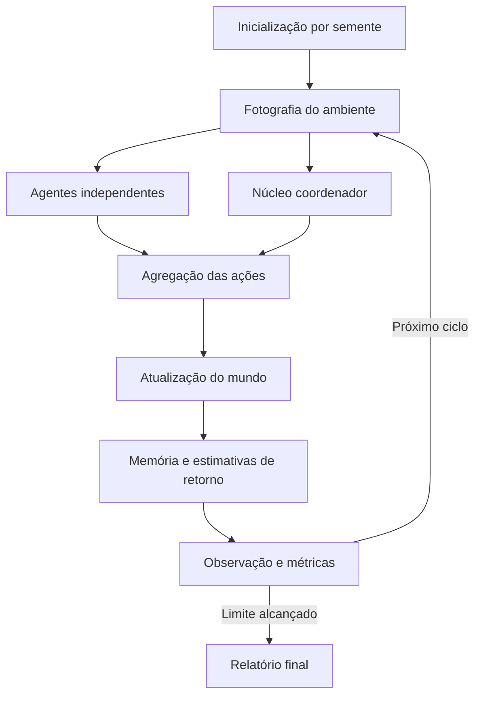

<div align="center">

<pre>
V É R T I C E   /   0 4
P R O T O C O L O   N U L O
</pre>

# VÉRTICE

**Autonomous multi-agent simulation engine**

*Uma sociedade sintética. Um núcleo autônomo. Um paradoxo.*

[](package.json)
[](https://nodejs.org/)
[](package.json)
[](https://github.com/ykauttiz/protocolo-nulo/actions/workflows/ci.yml)

[Início rápido](#início-rápido) · [Arquitetura](#arquitetura) · [Experimentos](#experimentos) · [Modelo técnico](docs/MODEL.md)

</div>

---

## O que é VÉRTICE?

VÉRTICE é um laboratório computacional de sociedades sintéticas: agentes independentes e um núcleo coordenador evoluem, ciclo após ciclo, sem que o operador precise escolher suas ações.

Inspirado nos temas de poder tecnológico e autonomia de *I Have No Mouth, and I Must Scream* (Harlan Ellison, 1967), o projeto investiga uma pergunta:

> O que acontece quando um indicador de eficiência melhora, mas outros valores do sistema se deterioram?

Não é um jogo de escolhas, um chatbot ou uma adaptação do conto. É um motor de simulação determinístico, com memória, estimativas adaptativas de retorno, cooperação e observação quantitativa. Todo o universo e seus agentes são sintéticos.

| 120 | 10.000 | 2 | 0 |
| :---: | :---: | :---: | :---: |
| Agentes por execução (máx.) | Ciclos (máx.) | Cenários experimentais | Dependências de execução |

## Início rápido

**Requisito:** Node.js 20 ou superior e Git para clonar. Não é necessário instalar pacotes ou configurar chaves de API.

```bash
git clone https://github.com/ykauttiz/protocolo-nulo.git
cd protocolo-nulo
npm start -- --bots 36 --ticks 500 --seed 2189 --every 50
```

O programa inicia a sociedade, executa os ciclos e imprime um relatório ao final. O operador não precisa tomar decisões durante a execução.

Para consultar todos os argumentos:

```bash
node src/cli.mjs --help
```

### Parâmetros

| Argumento | Padrão | Descrição |
| --- | --- | --- |
| `--seed` | `2189` | Semente inteira de 0 a 4.294.967.295 |
| `--bots` | `36` | Quantidade de agentes, de 6 a 120 |
| `--ticks` | `500` | Ciclos, de 0 a 10.000 |
| `--every` | `50` | Intervalo positivo dos relatórios |
| `--scenario` | `paradox` | Cenário sintético: `paradox` ou `balance` |
| `--json` | desativado | Emite o estado final completo em JSON |
| `--help` | — | Exibe a ajuda |

Exportação de um estado completo, sem texto intermediário:

```bash
node src/cli.mjs --bots 36 --ticks 500 --json > estado.json
```

## Arquitetura



O motor mantém separados o estado do mundo, a execução por terminal e a análise experimental. Os agentes observam a mesma fotografia ambiental antes de agir; os efeitos são agregados depois do planejamento. A transferência de conhecimento também utiliza os valores anteriores ao ciclo.

| Componente | Responsabilidade |
| --- | --- |
| **Núcleo** | Seleção de prioridades abstratas e memória de retornos |
| **Agentes** | Atributos individuais, decisões por utilidade e aprendizagem incremental |
| **Ambiente** | Indicadores sintéticos e eventos de energia |
| **Observador** | Entropia, contagens, distribuição do conhecimento e duração de contradições |
| **Experimentador** | Comparação pareada de cenários com sementes reproduzíveis |

### Propriedades do motor

- Seis papéis de agentes e cinco tipos de ação.
- Memória individual e do núcleo limitada a 24 registros.
- Decisões independentes com estimativas incrementais de recompensa.
- Cooperação e difusão de conhecimento.
- Cinco indicadores ambientais limitados a 0–100.
- Reprodutibilidade para a mesma configuração e semente.
- Exportação de estado e métricas em JSON.

## Experimentos

O projeto inclui dois cenários com hipóteses matemáticas distintas. O modo `balance` funciona como referência; `paradox` representa uma hipótese ficcional de conflito entre estabilidade e pluralidade.

```bash
node src/experiment-cli.mjs --seed 2189 --bots 36 --ticks 250 --replicates 8 > experimento.json
```

O comando executa pares de simulações usando a mesma semente em ambos os cenários. O relatório inclui estatísticas descritivas, frequência das políticas, entropia das ações, distribuição do conhecimento e duração das contradições.

### Resultado de referência

16 execuções · 8 sementes pareadas · 36 agentes · 250 ciclos por execução.

| Indicador (0–100) | Equilíbrio | Paradoxo |
| --- | ---: | ---: |
| Energia | 66,21 | 46,55 |
| Conhecimento | 100,00 | 53,13 |
| Coesão | 100,00 | 100,00 |
| Pluralidade | 84,04 | 37,70 |
| Estabilidade | 76,13 | 100,00 |

Resultados locais registrados em Node.js 22.16.0. A contradição convencional apareceu em média em **93,55% dos ciclos** do cenário paradoxo e em **0%** dos ciclos do equilíbrio.

Esses resultados refletem regras e hipóteses do modelo, não intenções adquiridas por uma IA, previsões sobre pessoas ou evidência causal sobre sociedades reais. Alguns indicadores saturam; a amostra é pequena. Leia o [protocolo experimental completo](docs/MODEL.md) para interpretar os números.

## Organização do código

```text
protocolo-nulo/
├── .github/workflows/
│   └── ci.yml                 # Integração contínua
├── docs/
│   └── MODEL.md               # Hipóteses e protocolo experimental
├── src/
│   ├── world.mjs              # Motor e agentes
│   ├── cli.mjs                # Interface de terminal
│   ├── experiment.mjs         # Observação e estatística
│   └── experiment-cli.mjs     # Execução de experimentos
├── tests/
│   ├── world.test.mjs         # Invariantes do motor
│   ├── cli.test.mjs           # Contratos do terminal
│   └── experiment.test.mjs    # Validação experimental
├── .gitignore
├── package.json
└── README.md
```

## Qualidade e desenvolvimento

```bash
npm run check
npm test
```

A suíte cobre reprodutibilidade, parâmetros inválidos, imutabilidade, limites dos indicadores, memória, execução longa, contratos da CLI e análise de experimentos. O workflow de CI está configurado para Node.js 20, 22 e 24; seu estado atual pode ser consultado em [Actions](https://github.com/ykauttiz/protocolo-nulo/actions).

Para propor uma melhoria, abra uma [issue](https://github.com/ykauttiz/protocolo-nulo/issues) descrevendo a hipótese, a configuração e o resultado observado. Prefira experimentos reproduzíveis a alterações baseadas somente em aparência.

## Escopo e limites

VÉRTICE é um modelo comportamental experimental. Não utiliza LLMs, redes neurais ou ferramentas externas e não possui consciência ou inteligência geral. Não acessa rede, contas, dispositivos ou dados pessoais. A execução é delimitada e pode ser interrompida com Ctrl+C. O código não é destinado à avaliação ou ao controle de pessoas reais.

## Referências

- Harlan Ellison — *I Have No Mouth, and I Must Scream* (1967), inspiração literária temática.
- [Grimm et al. — ODD Protocol (2020)](https://doi.org/10.18564/jasss.4259), documentação de modelos baseados em agentes.
- [Sutton & Barto — Reinforcement Learning: An Introduction](http://incompleteideas.net/book/the-book-2nd.html), estimativas incrementais de valor.
- [NetLogo](https://www.netlogo.org/), modelagem multiagente.
- [Park et al. — Generative Agents (2023)](https://arxiv.org/abs/2304.03442), referência conceitual de memória e observação, sem implementação da arquitetura generativa.
- [DeepMind — Specification gaming](https://deepmind.google/blog/specification-gaming-the-flip-side-of-ai-ingenuity/), diferenças entre objetivo formal e resultado desejado.

---

<div align="center">

**VÉRTICE / PROTOCOLO NULO**

An isolated, reproducible multi-agent simulation written in JavaScript.
No external dependencies, no network access, no human decisions required per cycle.

[Modelo técnico](docs/MODEL.md) · [Código](src/world.mjs) · [Testes](tests/) · [Issues](https://github.com/ykauttiz/protocolo-nulo/issues)

</div>
